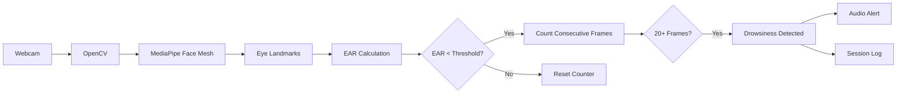

<div align="center">

# 👁️ Drowsiness Detection System

### Real-time AI-powered driver drowsiness detection

Detect prolonged eye closure through a webcam using computer vision, trigger an audio warning, and track drowsiness events from a clean Streamlit dashboard.


[Features](#-features) · [How it works](#-how-it-works) · [Quick start](#-quick-start) · [Configuration](#-configuration) · [Roadmap](#-roadmap)

</div>

---

## 🌿 About

**Drowsiness Detection System** is a real-time computer vision application that monitors eye activity through a webcam and detects prolonged eye closure.

The system uses **MediaPipe Face Mesh** to locate eye landmarks and calculates the **Eye Aspect Ratio (EAR)** to determine whether the eyes are closed. If the EAR remains below the configured threshold for a number of consecutive frames, the application displays a warning, plays an audio alert, and records the event.

The project is built with **Python and Streamlit**, making it easy to run and interact with locally.

## 🎯 Features

| | Feature | What it does |
|---|---|---|
| 👁️ | **Eye tracking** | Detects eye landmarks in real time using MediaPipe Face Mesh. |
| 📐 | **EAR calculation** | Measures eye openness using the Eye Aspect Ratio. |
| 🚨 | **Drowsiness detection** | Detects prolonged eye closure using consecutive-frame analysis. |
| 🔊 | **Audio alert** | Plays an alarm when drowsiness is detected. |
| 🎚️ | **Adjustable threshold** | Change the EAR sensitivity directly from the sidebar. |
| 📋 | **Session logging** | Records drowsiness and wake-up timestamps. |
| ⏱️ | **Duration tracking** | Calculates how long a drowsiness event lasted. |
| 🖥️ | **Streamlit dashboard** | Provides a simple interactive interface for detection and logs. |

## 🧩 How it works



### 👁️ Eye Aspect Ratio

The system calculates EAR using six landmark points around each eye:

```text
EAR = (Vertical Distance 1 + Vertical Distance 2)
      / (2 × Horizontal Distance)
```

The EAR of both eyes is averaged and compared against the selected threshold.

To reduce false alerts from normal blinking, the project requires **20 consecutive frames** below the threshold before triggering an alert.

## 🗂 Project structure

```text
drowsiness-detection/
├── app.py              # Main Streamlit application
├── alert.mp3           # Drowsiness warning sound
├── requirements.txt    # Python dependencies
├── README.md
└── .gitignore
```

## 🚀 Quick start

**Requirements:** Python 3.x, a working webcam, and a modern browser.

### 1. Get the code

```bash
git clone https://github.com/<your-username>/drowsiness-detection.git
cd drowsiness-detection
```

### 2. Create a virtual environment

```bash
python -m venv venv
```

Activate it:

| System | Command |
|---|---|
| Windows | `venv\Scripts\activate` |
| macOS / Linux | `source venv/bin/activate` |

### 3. Install dependencies

```bash
pip install -r requirements.txt
```

### 4. Add the alert sound

Place `alert.mp3` in the same directory as `app.py`.

### 5. Run the application

```bash
streamlit run app.py
```

Open the Streamlit URL shown in your terminal.

## 🎚️ Configuration

The sidebar provides two main controls:

| Setting | Default | Purpose |
|---|---:|---|
| **Start Detection** | Off | Starts or stops webcam detection. |
| **EAR Threshold** | `0.25` | Controls eye-closure sensitivity. |

If the system is too sensitive or not sensitive enough, adjust the EAR threshold from the sidebar.

## 📋 Session logging

When drowsiness is detected, the application records the event timestamp.

When the user becomes alert again, it records the wake-up time and calculates the approximate drowsiness duration.

Example:

```text
Timestamp              Status
2026-10-20 19:42:10    Drowsy
2026-10-20 19:42:14    Awake (after 4.2s)
```

## 🛠️ Tech stack

- **Python** — Core programming language
- **OpenCV** — Webcam capture and image processing
- **MediaPipe Face Mesh** — Facial and eye landmark detection
- **SciPy** — Euclidean distance calculations for EAR
- **Streamlit** — Interactive web interface
- **Pygame** — Audio alert playback
- **Pandas** — Session log display

## ⚠️ Limitations

- Performance can vary with lighting conditions.
- Camera angle and face visibility affect landmark detection.
- Glasses or partially covered eyes may reduce accuracy.
- A fixed EAR threshold may not work equally well for every user.
- Current logs are maintained for the active Streamlit session.
- This is an educational prototype, not a certified automotive safety system.

## 🗺 Roadmap

- [x] Real-time webcam detection
- [x] MediaPipe eye landmarks
- [x] EAR-based detection
- [x] Configurable threshold
- [x] Audio warning
- [x] Session logging
- [ ] Yawning detection
- [ ] Head-pose detection
- [ ] ML-based drowsiness classification
- [ ] Persistent database
- [ ] Advanced analytics dashboard
- [ ] Mobile integration

## 🤝 Contributing

Ideas and pull requests are welcome.

1. Fork the repository
2. Create a branch:
   ```bash
   git checkout -b feature/my-feature
   ```
3. Commit your changes:
   ```bash
   git commit -m "Add my feature"
   ```
4. Push and open a pull request

## 📄 License

Released under the [MIT License](LICENSE).

---

<div align="center">

Built with Python, OpenCV, MediaPipe and Streamlit 🚗

**Stay Awake. Stay Alert. Stay Safe. 👁️**

If you find this project useful, consider giving it a ⭐

</div>
